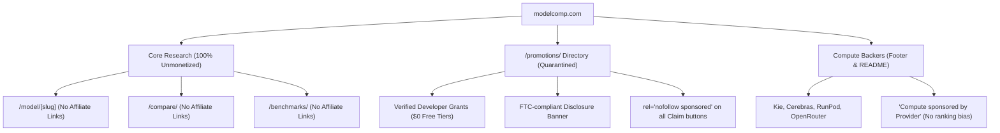

# 202611affiliaterules.md — Affiliate & Referral Architecture Rules

> **Target Audience:** Junior Developers, Maintainers, and Autonomous AI Agents  
> **Status:** Active Project Rule & Technical Reference  
> **Related Documents:**
> - [202611promotions.md](file:///e:/qwik/modelcomp/202611promotions.md) — Strategic planning for the `/promotions/` directory and research tasks.
> - [RULES.md](file:///e:/qwik/modelcomp/RULES.md) — Ultimate project rules (research permanence, scoring integrity).
> - [README.md](file:///e:/qwik/modelcomp/README.md) — Core brand promise ("Independent, no paid promotions").

---

## 1. The Core Philosophy: The Absolute "Air Gap"

Our project (`modelcomp`) derives 100% of its authority, user loyalty, and search indexation from **uncompromising research integrity**. We use multi-agent cross-verification, rater gates (>84.9), and strict empirical benchmarks.

> [!CAUTION]
> **The Golden Rule:** Commercial promotions or affiliate relationships must **NEVER** touch, influence, or be commingled with our benchmarks, `average.md` scores, or `/compare/` pages.
>
> An AI answer engine (Perplexity, ChatGPT Search, Gemini Search) or Googlebot will immediately strip citation privileges from our site if it detects that model scores or head-to-head recommendations are biased by referral commissions.

---

## 2. Why Search Engines & AI Models Care (SEO & GEO Impact)

### 2.1 Google Search Engine Perspective
1. **Google's Link Spam & Commercial Abuse Policy:**
   - Any link that includes an affiliate parameter (such as `?aff=`, `?ref=`, `?referral_code=`) and passes outbound traffic must be qualified with `rel="sponsored"` or `rel="nofollow"`.
   - **The Danger:** If an affiliate link uses only `rel="noopener noreferrer"`, Google’s automated crawlers classify it as an undeclared paid link designed to manipulate PageRank, which risks domain-wide penalties.
2. **Google's "Helpful Content" System & Information Gain:**
   - Thin coupon aggregators get penalized.
   - Authoritative directories that provide **substantial unique information** (e.g., verifying that a deal requires phone verification, tracking exact credit expiration dates, and verifying token amounts) are rewarded with top rankings.

### 2.2 GEO Systems Perspective (Gemini, ChatGPT Search, Perplexity)
1. **The Neutral Entity Graph:**
   - AI models ingest our factual claims because we provide neutral, unmonetized data.
   - When a user asks an AI *"Which AI model should I use for coding?"*, the AI searches for independent data.
2. **The "Commercial Bias" Penalty:**
   - If an AI crawler detects that the winning model on a comparison page links directly to an affiliate checkout, the AI's safety filter discounts the entire site as "commercially biased" and switches its citation to another source (e.g. LMSYS or HuggingFace).

---

## 3. Mandatory Implementation Rules

### Rule 1: Clean Data Integrity in `providers/*/meta.json` (No Affiliate Evidence)
- `officialUrl` must **always** be the clean, canonical homepage URL.
- `evidenceUrl` must **always** be an official documentation or pricing page. **Never put an affiliate link in `evidenceUrl`.** Evidence is factual proof, not a sales pitch.
- Store affiliate/referral links under an explicit, separate optional key: `referralUrl`.

#### ❌ Wrong (`providers/agentrouter/meta.json` legacy example):
```json
{
  "name": "AgentRouter",
  "officialUrl": "https://agentrouter.org/register?aff=a4U6",
  "plans": [
    {
      "name": "Free check-in credits",
      "evidenceUrl": "https://agentrouter.org/register?aff=a4U6"
    }
  ]
}
```

#### ✅ Correct:
```json
{
  "name": "AgentRouter",
  "officialUrl": "https://agentrouter.org",
  "referralUrl": "https://agentrouter.org/register?aff=a4U6",
  "plans": [
    {
      "name": "Free check-in credits",
      "price": "$0",
      "notes": "Earn free credits: daily $25 check-in, $50 per invite. Balance never expires.",
      "evidenceUrl": "https://agentrouter.org/docs/faq"
    }
  ]
}
```

---

### Rule 2: Mandatory `rel` Attributes on Outbound Links
Whenever rendering an outbound link in Qwik components (`src/routes/providers/index.tsx`, `src/routes/promotions/index.tsx`, etc.):

- **Standard non-commercial links:** `rel="noopener noreferrer"`
- **Any link containing an affiliate, referral, or sponsored tag:** `rel="noopener noreferrer nofollow sponsored"`

```tsx
// Junior Developer Tip: Use this helper logic when rendering provider cards
const isSponsored = Boolean(provider.referralUrl);
const targetUrl = provider.referralUrl || provider.officialUrl;

<a
  href={targetUrl}
  target="_blank"
  rel={isSponsored ? "noopener noreferrer nofollow sponsored" : "noopener noreferrer"}
  class="font-medium text-indigo-600 hover:underline dark:text-indigo-400"
>
  {provider.name}
</a>
```

---

### Rule 3: The Three Safe Monetization Models

To preserve our brand promise (*"Independent, no paid promotions — donations fund compute and research time, never rankings"*), follow these three patterns:



#### Model A: The Dedicated `/promotions/` Hub
- Keep all direct referral/affiliate links quarantined to `/promotions/` (or `/deals/`).
- At the top of `/promotions/`, include an explicit, FTC-compliant notice:
  > *"ModelComp is supported by our community. When you use the developer links below to claim free credits or trial tiers, we may receive compute credits. This never influences our automated AI benchmark scores or rankings."*
- Keep `/model/` profile pages and `/compare/` pages 100% affiliate-free. That way, the core research domain remains completely pristine for AI citations.

#### Model B: "Community Perk" Value-Add (Not Disguised Links)
- Never trick a user into clicking an affiliate link.
- If a provider gives free credits, label it explicitly:
  > **"Community Perk: Claim $25 Daily Check-In Credits on AgentRouter [Claim Bonus →]"**
- Users appreciate the transparency (they know *why* they should click your link), and search engines see a legitimate, disclosed sponsorship.

#### Model C: Cloud Compute Sponsorships (Highest Yield, Zero Risk)
- Instead of relying on individual referral clicks, reach out to emerging inference providers (e.g. Kie, Cerebras, OpenRouter, Nebius) to sponsor compute:
  - *"Compute sponsored by [Provider Name]"* in the footer (which we already do with Ko-fi and Patreon).
  - Providers are eager to give thousands of dollars in direct API compute credits to benchmarking projects in exchange for a clean backer logo in the footer.

#### Model D: The Dedicated Sister Domain (The Gold Standard of Isolation)
- **Concept:** Launch all affiliate, coupon, and commercial referral tracking on a completely separate domain and brand (e.g. `aideals.fyi`, `aideals.link`, or `modeldeals.dev`).
- **How it links to `modelcomp`:** 
  - Add the sister site as an official entry in `RESEARCH_BACKERS` in [`src/components/v2/V2Footer.tsx`](file:///e:/qwik/modelcomp/src/components/v2/V2Footer.tsx), identical to `ExtraWebSite`.
  - The link is already hardcoded with `rel="sponsored noopener noreferrer"` and title *"Research backer (logo placement thanks, never influences scores)"*.
- **Why this eliminates 100% of risk:**
  1. Google evaluates domains on a per-hostname basis. Commercial coupon or referral scrutiny on Domain B cannot spill over to Domain A (`modelcomp`).
  2. `modelcomp` remains a pristine, 100% unmonetized benchmark authority that AI answer engines (ChatGPT, Perplexity, Gemini) will cite with zero commercial-bias penalties.
  3. The sister domain gains high-authority legitimacy by citing `modelcomp` as its empirical data source (*"Rankings & benchmarks verified by ModelComp.com"*).

---

## 4. Auditor Checklist for Developers & AI Agents

Before submitting changes or running `pnpm sync`:
- [ ] Are all `officialUrl` and `evidenceUrl` values in `providers/*/meta.json` clean of `?aff=`, `?ref=`, and tracking codes?
- [ ] Are any referral links stored exclusively in `referralUrl`?
- [ ] Do all rendered referral links have `rel="noopener noreferrer nofollow sponsored"`?
- [ ] Are `/model/` and `/compare/` completely free of commercial affiliate links?
- [ ] If linking a commercial sister site in the footer, is it strictly marked with `rel="sponsored"` under `RESEARCH_BACKERS`?

