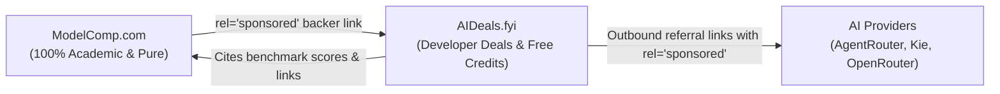

# PRD: AI Deals & Free Credit Directory (Sister Site)

> **Document Type:** Product Requirements Document (PRD) & Domain Strategy  
> **Target Audience:** Junior Developers, Maintainers, and Autonomous AI Agents  
> **Companion Documents:**
> - [202611affiliaterules.md](file:///e:/qwik/modelcomp/202611affiliaterules.md) — Mandatory affiliate link & isolation rules.
> - [202611promotions.md](file:///e:/qwik/modelcomp/202611promotions.md) — Strategic analysis of commercial promotions vs. empirical benchmarks.
> - [202611expandingPRD.md](file:///e:/qwik/modelcomp/202611expandingPRD.md) — Main site SEO/GEO expansion PRD.

---

## 1. Domain Investigation & Name Recommendation

### 1.1 The Criteria for a "Bullseye" Domain
To succeed in both developer trust and algorithmic search rankings (SEO/GEO), the domain must satisfy:
1. **Developer Trust & Technical Resonance:** Developers are skeptical of scam coupon aggregators. TLDs like `.party`, `.review`, or `.info` historically trigger spam heuristics and feel like low-effort affiliate farms.
2. **Memorability & Direct Type-In:** Short, clean, hyphen-free, and easy to spell.
3. **Synergy with ModelComp:** Positions the site as an authoritative directory of developer grants, API credits, and model discounts.

### 1.2 Evaluation of Candidate Domains

| Candidate Domain | Availability | Developer Trust Rating | SEO / Algorithmic Perception | Verdict |
| :--- | :--- | :--- | :--- | :--- |
| **`aideals.fyi`** | **Available** | ⭐⭐⭐⭐⭐ (9.5/10) | **Excellent**. `.fyi` is the gold standard in tech for directories, trackers, and informational hubs (e.g. *levels.fyi*). High prestige among engineers. | 🎯 **Top Recommendation #1** |
| **`aideals.link`** | **Available** | ⭐⭐⭐⭐☆ (8.0/10) | **Good**. Short, clean, modern. Works well for curated link lists and resource registries. | 🥈 **Strong Runner-up** |
| **`modeldeals.dev`** | Check avail. | ⭐⭐⭐⭐⭐ (9.0/10) | **Great**. Directly parallels `modelcomp`. Natural fit for AI model API discounts. | 🥈 **Great Alternative** |
| `aideals.page` | Available | ⭐⭐⭐☆☆ (6.5/10) | Average. Feels like a single landing page or personal portfolio rather than a platform. | ⚠️ Pass |
| `aideals.website` | Available | ⭐⭐☆☆☆ (4.0/10) | Low. Generic and clunky. | ❌ Avoid |
| `aideals.info` | Available | ⭐⭐☆☆☆ (3.5/10) | Low. Strong legacy spam associations with low-quality affiliate blogs. | ❌ Avoid |
| `aideals.review` | Available | ⭐⭐☆☆☆ (3.0/10) | Poor. Signals a biased "fake review" affiliate site. | ❌ Avoid |
| `aideals.party` | Available | ⭐☆☆☆☆ (1.0/10) | Very poor. Unprofessional; blocked by enterprise DNS filters. | ❌ Avoid |

### 1.3 The Bullseye Recommendation: `aideals.fyi`
> [!TIP]
> **Why `aideals.fyi` wins:**
> The `.fyi` TLD carries immense credibility in the tech developer ecosystem due to the massive success of *levels.fyi*. It reads as **"For Your Information"**—a curated, verified tracker of AI grants and developer credits rather than a sketchy coupon site.
> 
> *If `aideals.fyi` is acquired, the site identity is branded as **AIDeals.fyi — The AI Developer Deals & Free Credit Tracker**.*

---

## 2. Product Vision & Value Proposition

### 2.1 The Pitch
**AIDeals.fyi** is the developer-first directory tracking free API credits, sign-up grants, student perks, and active discounts for AI models, inference engines, and developer tools.

### 2.2 The "Moat" (Powered by ModelComp)
Unlike generic affiliate sites, every deal on `aideals.fyi` is paired with **empirical performance data from ModelComp.com**:
- *"Claim $10 free credits for Model X (Ranked #3 on ModelComp Coding Index with 92.5 score)."*
- This provides genuine **Information Gain** that Google’s helpful content system rewards and provides a defensible moat against copycat coupon sites.



---

## 3. Brand Identity & Official Logo

The visual mark for **`aideals.fyi`** unites frontier AI infrastructure (the 4-pointed spark) with developer value / grants (the 45-degree angled compute badge), styled in the signature Electric Indigo to Mint Emerald gradient (`#6366f1` → `#10b981`).

### 3.1 Official Vector SVG (Final Version)

```xml
<svg viewBox="8.203 8.203 183.594 183.594" fill="none" xmlns="http://www.w3.org/2000/svg">
  <defs>
    <!-- Brand Gradient: AI Intelligence to Unlocked Credit -->
    <linearGradient id="ai-deal-grad" x1="0%" y1="0%" x2="100%" y2="100%">
      <stop offset="0%" stop-color="#6366f1"/>
      <stop offset="100%" stop-color="#10b981"/>
    </linearGradient>
    <!-- Soft glow effect -->
    <filter id="glow" x="-20%" y="-20%" width="140%" height="140%">
      <feGaussianBlur stdDeviation="8" result="blur"/>
      <feComposite in="SourceGraphic" in2="blur" operator="over"/>
    </filter>
  </defs>
  <!-- Angled Modern Tech Badge / Tag -->
  <rect x="35" y="35" width="130" height="130" rx="32" transform="rotate(45 100 100)" fill="url(#ai-deal-grad)" filter="url(#glow)"/>
  <!-- Inner Dark Core for Contrast -->
  <rect x="42" y="42" width="116" height="116" rx="26" transform="rotate(45 100 100)" fill="#090d16"/>
  <!-- 4-Pointed AI Frontier Spark (The Deal Beacon) -->
  <path
    transform="translate(100 100) scale(1.35) translate(-100 -100)"
    d="M100 55 C100 80 120 100 145 100 C120 100 100 120 100 145 C100 120 80 100 55 100 C80 100 100 80 100 55 Z" fill="url(#ai-deal-grad)"/>
  <!-- Subtle Token Dot in the Core -->
  <circle cx="100" cy="100" r="3" fill="#eee"/>
</svg>
```

### 3.2 Color Palette Strategy

Developers trust deep, technical dark palettes accented with energetic compute glows. The colors convey growth, unlocked credits, and value without feeling like a bargain discount bin:

| Role | Color Name | Hex / Tailwind | Meaning & Usage |
| :--- | :--- | :--- | :--- |
| **Value & Credits** | Mint Emerald | `#10b981` / `emerald-500` | Unlocked credits, `$0` free tiers, positive CI terminal signals. |
| **Intelligence** | Electric Indigo | `#6366f1` / `indigo-500` | Frontier AI models, API infrastructure, neural weights. |
| **Brand Transition** | Gradient Glow | `#6366f1` → `#10b981` | Visual metaphor: AI Compute (Indigo) → Free Value & Credits (Emerald). |
| **Void Dark Surface** | Dark Canvas | `#090d16` / `#020617` | High-contrast background for chips, badges, and dark mode UI. |
| **Muted Text / Mono** | Slate Muted | `#94a3b8` / `slate-400` | Subtitles, verification dates, domain badges, and footnotes. |

### 3.3 Typography & Wordmark

The wordmark balances modern developer-native sans-serif with monospace accents:

```
[ ai ] deals . fyi
```

- **`ai`**: Heavyweight (`font-extrabold text-white` or Electric Indigo `#6366f1`).
- **`deals`**: Semibold weight with the signature gradient (`font-semibold bg-gradient-to-r from-indigo-400 to-emerald-400 bg-clip-text text-transparent`).
- **`.fyi`**: Muted monospaced pill badge:
  ```html
  <span class="ml-1 rounded border border-slate-700 bg-slate-800/60 px-1.5 py-0.5 font-mono text-xs text-slate-300">.fyi</span>
  ```

---

## 4. Architecture & Tech Stack

To maximize developer velocity and code reuse, `aideals.fyi` will share the identical tech stack as `modelcomp`:

1. **Framework:** Qwik 1.20 + Vite 7 (Static Site Generation / SSG).
2. **Styling:** Tailwind v3 (reusing the clean dark/light canvas from `src/components/v2/`).
3. **Data Source:** Dedicated `data/deals.json` file populated by automated agent sweeps.
4. **Hosting:** Vercel or Cloudflare Pages (free-tier static hosting).

---

## 5. Data Specification: `data/deals.json`

Every deal must conform to this TypeScript schema:

```ts
export type DealType = "free_credits" | "free_tier" | "discount" | "referral_perk";

export interface Deal {
  id: string;                      // e.g. "agentrouter-checkin-bonus"
  providerSlug: string;            // matches modelcomp provider slug (e.g. "agentrouter")
  providerName: string;            // e.g. "AgentRouter"
  officialUrl: string;             // clean URL: "https://agentrouter.org"
  referralUrl: string;             // operator referral: "https://agentrouter.org/register?aff=a4U6"
  dealType: DealType;              // badge category
  headline: string;                // "Daily $25 Free Check-In Credits"
  description: string;             // "Earn free credits on daily check-ins. No minimum spend."
  valueBadge: string;              // "$25 Free Credits" or "50% Off"
  requiresCard: boolean;           // false = "No Card Required" badge
  requiresPhone: boolean;          // true = "Phone Verification Required"
  promoCode?: string;              // optional promo code to copy
  verifiedDate: string;            // "2026-11-12"
  expiresDate: string | null;      // "2026-12-31" or null if ongoing
  modelcompScore?: number;         // e.g. 93.8 (linked to model profile)
  status: "active" | "expired";
}
```

---

## 6. UI & Feature Requirements

### 6.1 Hero Section
- **H1:** "The AI Developer Deals & Free Credit Tracker"
- **Subtitle:** "Curated grants, API discounts, and welcome credits for frontier AI models. Verified by developers, benchmarked by ModelComp."
- **Search & Filter Bar:**
  - Fast instant text search (by provider or model).
  - Filter pills: `All Deals`, `No Credit Card Needed ($0)`, `Inference Credits`, `API Discounts`.

### 6.2 Deal Card Component
Each deal is rendered as a clean Tailwind card:
- **Header:** Provider icon + Provider Name + ModelComp score pill (if applicable).
- **Badges:**
  - Type badge: `Free Credits` (emerald), `Discount` (indigo), `Community Perk` (purple).
  - Condition badge: `No Credit Card Required` (slate).
- **Body:** Headline + short descriptive notes + verification date stamp (`Verified Nov 2026`).
- **Call-to-Action Buttons:**
  - `Claim Deal →`: Outbound button pointing to `referralUrl` with:
    `target="_blank" rel="noopener noreferrer nofollow sponsored"`
  - `View Model Benchmarks`: Clean internal link pointing to `https://modelcomp.com/model/<slug>`.

### 6.3 Mandatory Compliance & Disclosure
- **Top Sticky Disclosure Banner:**
  > *"Disclosure: AIDeals.fyi is independent and developer-supported. When you claim free credits or subscriptions via links on this site, we may earn compute credits or commissions at no additional cost to you. Benchmarks cited from ModelComp.com are strictly empirical and never influenced by commercial partnerships."*
- **Footer:** Links back to `ModelComp.com` as the official benchmark partner.

---

## 7. Autonomous AI Agent Task (`tasks/deals-audit.md`)

A dedicated agent brief for discovering and refreshing deals on a recurring schedule:

### Agent Instructions:
1. **Target:** Iterate over the 150+ providers from `providers/*/meta.json`.
2. **Search Operators:**
   - `site:<officialUrl> "free credit" OR "trial" OR "promo" OR "referral"`
   - `"<provider>" free credits 2026 developer grant`
3. **Extraction Rules:**
   - Must verify whether a credit card is required.
   - Must capture expiration dates.
   - Must flag if the operator needs to generate a unique referral link.
4. **Output:** Appends or updates entries in `data/deals.json`.

---

## 8. Step-by-Step Implementation Roadmap

- [ ] **Step 1: Domain Registration & Setup**
  - Register `aideals.fyi` (or `aideals.link`).
  - Configure DNS on Cloudflare / Vercel.
- [ ] **Step 2: Scaffold Repository**
  - Clone or branch the lightweight Qwik + Tailwind v3 template from `modelcomp`.
  - Strip model benchmark calculations; retain `V2Header`, `V2Footer`, and theme engine.
- [ ] **Step 3: Ingest Initial Deals Dataset**
  - Seed `data/deals.json` with existing known deals:
    - Cerebras ($5 one-time promotional credit).
    - AgentRouter ($25 daily check-in bonus).
    - Kie.ai (80 free welcome credits).
    - OpenCode Zen (Gemini 4 Argon 50% discount).
    - PPIO (~5M free tokens upon signup).
- [ ] **Step 4: Build Deal Directory UI**
  - Build interactive filter pills (`No Card Needed`, `Free Credits`, etc.).
  - Implement deal card grid with copy-to-clipboard promo code widgets.
  - Apply `rel="noopener noreferrer nofollow sponsored"` to all outbound links.
- [ ] **Step 5: ModelComp Footer Backer Integration**
  - In `modelcomp`'s `src/components/v2/V2Footer.tsx`:
    - Add `AIDeals.fyi` to `RESEARCH_BACKERS` with `rel="sponsored noopener noreferrer"`.
- [ ] **Step 6: Deploy & Submit Sitemaps**
  - Deploy static build to production.
  - Submit `sitemap.xml` to Google Search Console and Bing Webmaster.

