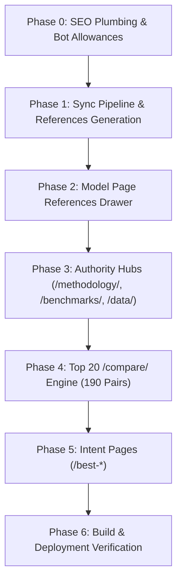

# PRD: SEO & GEO Expansion Engine (2026-11)

> **Document Type:** Product Requirements Document (PRD) & Technical Implementation Specification  
> **Status:** Ready for Implementation  
> **Target Audience:** Junior Developers & AI Autonomous Agents  
> **Target Architecture:** Qwik 1.20 + Tailwind v3 + Static Site Generation (SSG) + Node 22 (`pnpm`)  
> **Validation Rule:** All commands must run on Windows pwsh using `:direct` shims. Never run bare terminal builds mid-task without need.

---

## 1. Executive Summary & Strategic Objectives

### 1.1 Goal
Transform `modelcomp` from an internal model benchmark viewer into the primary, authoritative, cited data source for AI search engines (SearchGPT, Perplexity, Gemini Search) and web crawlers (Googlebot, Bingbot).

### 1.2 Core Pillars
1. **Zero-Overhead Data Pipeline:** Build-time extraction of URLs and benchmark leaderboards via `pnpm sync` into generated TypeScript modules (`references.generated.ts`, `benchmarks.generated.ts`). Never parse markdown or heavy file trees dynamically at runtime.
2. **Reusability & Simplicity:** 100% reuse of existing UI components (`CompareSection.tsx`, `hex.ts`, `V2Header.tsx`, `V2Footer.tsx`, `VendorIcon.tsx`, `theme.ts`).
3. **Crawl Budget & Anti-Thin-Content Safety:** 
   - Static SSG pre-rendering of **Top 20 overall models** resulting in exactly $\binom{20}{2} = 190$ two-model comparison pages (`/compare/model-a-vs-model-b/`).
   - Dynamic client-side interactive fallback on the `/compare/` route for all other combinations or 3-way trios.
4. **Authority Anchors:** Dedicated landing pages for `/benchmarks/`, `/methodology/`, `/data/`, and intent rankings (`/best-ai-models-for-coding/`, `/best-free-llm-for-coding/`).
5. **Commercial Quarantine:** Isolate any future referral/promotional paths under `/promotions/` with `rel="nofollow sponsored"` to preserve editorial credibility.

---

## 2. Technical Stack & File Map

### 2.1 Toolchain & Conventions
- **Framework:** Qwik 1.20 (TypeScript).
- **CSS:** Tailwind v3 (Utility classes only; no external CSS frameworks).
- **Package Manager:** `pnpm`.
- **Command Shims (Windows requirement):**
  - Validation / Typecheck: `pnpm build.types:direct`
  - Build / SSG: `pnpm build:direct`
  - Pipeline Sync: `pnpm sync`

### 2.2 Key File Locations
| Purpose | Target File Path |
| :--- | :--- |
| Sync Script | `scripts/sync-data.mjs` |
| Benchmark Vocabulary | `scripts/lib/benchmarks.mjs` |
| Code Generator | `scripts/lib/codegen.mjs` |
| References Data Module | `src/data/references.generated.ts` (Auto-generated) |
| Benchmark Data Module | `src/data/benchmarks.generated.ts` (Auto-generated) |
| References UI Component | `src/components/v2/ReferencesSection.tsx` |
| Model Profile Route | `src/routes/model/[slug]/index.tsx` |
| Compare Dynamic Route | `src/routes/compare/[...pair]/index.tsx` |
| Methodology Route | `src/routes/methodology/index.tsx` |
| Benchmarks Hub Route | `src/routes/benchmarks/index.tsx` |
| Public Data Export Route | `src/routes/data/index.tsx` |
| Coding Intent Route | `src/routes/best-ai-models-for-coding/index.tsx` |
| Free LLM Intent Route | `src/routes/best-free-llm-for-coding/index.tsx` |

---

## 3. Phase-by-Phase Implementation Specifications



---

### Phase 0: SEO Plumbing & Bot Allowances

#### Requirements:
1. Update `scripts/lib/codegen.mjs` in the `renderRobotsTxt` function.
2. Explicitly declare `Allow: /` for AI search indexers: `OAI-SearchBot`, `GPTBot`, `PerplexityBot`, `Claude-Web`, and `Google-Extended`.
3. Ensure `sitemap.xml` references use the canonical site origin.

#### Junior Developer Explanation:
> AI search engines check `robots.txt` before indexing pages for citation. If we explicitly welcome them, bots like ChatGPT Search and Perplexity will prioritize indexing our comparison pages.

---

### Phase 1: Pipeline Enrichment (`pnpm sync`)

#### Target Files:
- `scripts/sync-data.mjs`
- `scripts/lib/codegen.mjs`

#### Requirements:
1. **References Harvester:**
   - In `sync-data.mjs`, when looping over `model/<slug>/*.md` findings files:
     - Scan content for Markdown links `[text](url)` and bare URLs (`https://...`).
     - Filter out localhost, internal relative links, and template placeholder domains.
     - Extract the domain name as `domain` (e.g. `github.com`, `arxiv.org`, `openai.com`).
     - Deduplicate URLs per model slug.
   - Emit `src/data/references.generated.ts`:
     ```ts
     export interface ReferenceItem {
       url: string;
       title: string;
       domain: string;
       sourceStem: string;
     }
     export const REFERENCES: Record<string, ReferenceItem[]> = { ... };
     ```
2. **Benchmark Leaderboard Aggregator:**
   - Group the already computed `evidenceIndex` by benchmark name.
   - Emit `src/data/benchmarks.generated.ts`:
     ```ts
     export interface BenchmarkEntry {
       name: string;
       modelSlug: string;
       modelName: string;
       value: string;
       numericValue: number;
       ratersCount: number;
     }
     export const BENCHMARKS_DATA: Record<string, BenchmarkEntry[]> = { ... };
     ```

---

### Phase 2: Model Page References Drawer

#### Target Files:
- `src/components/v2/ReferencesSection.tsx` (New component)
- `src/routes/model/[slug]/index.tsx`

#### Requirements:
1. Create a component that receives `slug: string`.
2. Look up `REFERENCES[slug] ?? []`.
3. If empty, return `null`.
4. Render as a semantic HTML `<details>` disclosure widget:
   ```tsx
   <details class="group rounded-2xl border border-slate-200 bg-white p-6 shadow-sm dark:border-slate-800 dark:bg-slate-900">
     <summary class="flex cursor-pointer items-center justify-between text-base font-semibold text-slate-900 dark:text-white">
       <span>Evidence & Research Citations ({references.length})</span>
       <span class="transition-transform group-open:rotate-180">▼</span>
     </summary>
     <div class="mt-4 divide-y divide-slate-100 dark:divide-slate-800">
       {/* Loop through citations with title, clean domain chip, and rel="noopener noreferrer nofollow" */}
     </div>
   </details>
   ```
5. Place this section right below the "Verified Evidence" table in `src/routes/model/[slug]/index.tsx`.

---

### Phase 3: Authority Hubs (`/methodology/`, `/benchmarks/`, `/data/`)

#### 3.1 `/methodology/`
- **Route:** `src/routes/methodology/index.tsx`
- **Structure:**
  - Wrap in `V2Header` and `V2Footer` with `usePageTheme()`.
  - Promotes the existing `MethodologySection.tsx` content into a standalone document.
  - Explain:
    - AI research multi-agent consensus (minimum 2 agreeing raters).
    - Rater quality gate (> 84.9 threshold).
    - Subcategory weighting (Reasoning, Coding, Context, Tool Use, Multimodal, Cost).
    - Policy: Independence, zero sponsored ranking bias.

#### 3.2 `/benchmarks/`
- **Route:** `src/routes/benchmarks/index.tsx`
- **Structure:**
  - Load `BENCHMARKS_DATA` from `src/data/benchmarks.generated.ts`.
  - List all 25+ tracked benchmarks (SWE-bench Verified, LiveCodeBench, HumanEval, Terminal-Bench, etc.).
  - For each benchmark:
    - Display definition and description.
    - Render a top-10 leaderboard table of models with verified scores.
  - Include Schema.org `Dataset` JSON-LD in `DocumentHead`.

#### 3.3 `/data/`
- **Route:** `src/routes/data/index.tsx`
- **Structure:**
  - Provide direct download links for machine-readable formats:
    - Raw JSON snapshot (`/data/scores.json`).
    - Raw CSV export (`/data/scores.csv`).
  - Clear open data license note (CC BY 4.0) with instructions on how LLMs and academic researchers can cite `modelcomp.com`.

---

### Phase 4: Head-to-Head Compare Engine (`/compare/`)

#### 4.1 Route Architecture
- **Route:** `src/routes/compare/[...pair]/index.tsx`
- Handles paths like `/compare/` (interactive picker) and `/compare/claude-opus-5.5-vs-gemini-4-argon/`.

#### 4.2 Combinatorial Curation (Top 20 Models = 190 Pairs)
In `onStaticGenerate`:
```ts
export const onStaticGenerate: StaticGenerateHandler = () => {
  // 1. Take top 20 models by Overall score from MODELS roster
  const top20 = MODELS.slice(0, 20);
  const pairs: { pair: string }[] = [];

  for (let i = 0; i < top20.length; i++) {
    for (let j = i + 1; j < top20.length; j++) {
      // 2. Alphabetical canonical slug order ensures no duplicates
      const [slugA, slugB] = [top20[i].slug, top20[j].slug].sort();
      pairs.push({ pair: `${slugA}-vs-${slugB}` });
    }
  }

  // Exact math: 20 * 19 / 2 = 190 pairs
  return { params: pairs };
};
```

#### 4.3 Automated Verdict Generation (Anti-Thin-Content Engine)
To prevent Google from flagging compare pages as low-quality boilerplate, dynamically compute a 2–3 sentence data-driven verdict based on subcategory score deltas:
```ts
function generateVerdict(modelA: AiModel, modelB: AiModel): string {
  // Compute deltas across coding, reasoning, context, and cost
  // If delta is between -1.0 and +1.0, declare as "comparable" (noise floor)
  // If delta > 1.0, state the exact point lead
  // Output a factual, dated sentence:
  // "As of [DATE], Model A leads Model B in Coding by +5.2 points, while Model B offers a 30% lower cost per million tokens."
}
```

#### 4.4 UI Integration
- Render the auto-generated verdict at the top of the comparison.
- Mount the existing `CompareSection` passing `cmpA={slugA}` and `cmpB={slugB}`.
- Keep the dropdown selectors active so users can change models interactively.

---

### Phase 5: Intent Landing Pages (`/best-*`)

#### 5.1 `/best-ai-models-for-coding/`
- **Route:** `src/routes/best-ai-models-for-coding/index.tsx`
- **Data Source:** Pull models sorted by `scores.coding` descending.
- **UI:** Top-10 Coding models breakdown with radar visualization and direct link to their individual profiles.

#### 5.2 `/best-free-llm-for-coding/`
- **Route:** `src/routes/best-free-llm-for-coding/index.tsx`
- **Data Source:** Filter models where `hasFreeTier(m)` is true, sorted by Overall score.
- **UI:** Display free-tier allowance details, claimant citation link, and verified coding score.

---

## 4. Step-by-Step Implementation Checklist for Autonomous Agents

When assigned to implement this PRD, follow these exact steps in unbroken sequence:

- [ ] **Task 1: Robots.txt & Schema Base**
  - Edit `scripts/lib/codegen.mjs` to include search bots (`OAI-SearchBot`, `GPTBot`, `PerplexityBot`, `Claude-Web`).
  - Run `pnpm sync` to regenerate `public/robots.txt`.
- [ ] **Task 2: References & Benchmarks Generator**
  - Add URL regex harvesting to `scripts/sync-data.mjs`.
  - Emit `src/data/references.generated.ts` and `src/data/benchmarks.generated.ts`.
  - Validate with `pnpm sync`.
- [ ] **Task 3: References Component on Profile Pages**
  - Create `src/components/v2/ReferencesSection.tsx`.
  - Insert into `src/routes/model/[slug]/index.tsx` below the evidence table.
- [ ] **Task 4: Create Static Hub Routes**
  - Create `src/routes/methodology/index.tsx`.
  - Create `src/routes/benchmarks/index.tsx`.
  - Create `src/routes/data/index.tsx`.
- [ ] **Task 5: Implement `/compare/` Dynamic Engine**
  - Create `src/routes/compare/[...pair]/index.tsx`.
  - Implement Top-20 `onStaticGenerate` (190 routes).
  - Implement automated verdict generator.
  - Wire to `CompareSection.tsx`.
- [ ] **Task 6: Create Intent Ranking Pages**
  - Create `src/routes/best-ai-models-for-coding/index.tsx`.
  - Create `src/routes/best-free-llm-for-coding/index.tsx`.
- [ ] **Task 7: Final Validation**
  - Run `pnpm build.types:direct` (must exit 0 with no TypeScript errors).
  - Run `pnpm build:direct` (must complete SSG generation including the 190 compare routes and static pages).
